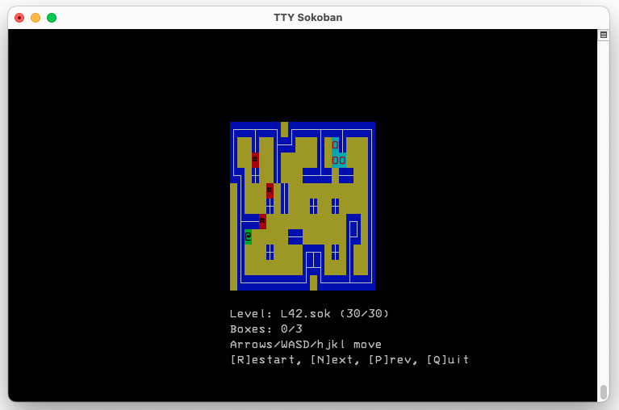

# TTY Sokoban



A terminal-based Sokoban game written in C using the curses library.

## Description

TTY Sokoban is a simple implementation of the classic Sokoban puzzle game for terminal/TTY environments. The game features ASCII line drawing for walls, making it visually appealing in terminal environments.

## Requirements

- C compiler (like GCC)
- curses library

## Building

```
make
```

This will:
1. Compile the embed_levels tool
2. Generate the embedded_levels.h file from levels in the levels/ directory
3. Compile the game with the embedded levels

### Old curses (Whitesmiths Idris)

`oldcurses.h` builds ttysokoban with an old 4.2BSD style curses: no colors, no keypad, no attributes but standout. It was made for the 1985 UNISCREEN curses of Whitesmiths Idris, and tested on Idris 3.14 on an Atari Mega ST in Hatari. The arrow keys are read as VT52 or VT100 escape sequences.

1. On a modern machine: `make embedded_levels.h`
2. Copy `ttysokoban.c`, `levels.h`, `embedded_levels.h`, `oldcurses.h`, `oldcurses.c` and `mksok` to Idris.
3. On Idris: `sh mksok`

Idris keeps only the first 14 letters of a file name, so `embedded_levels.h` is stored as `embedded_level`. The `#include` still finds it.

## Running the Game

```
./ttysokoban
```

Flags:

```
-a, --ascii    Use ASCII characters for walls instead of box drawing characters
-b, -bw        Black and white mode (disable colors)
```

## Game Controls

- Movement:
  - Arrow keys: Move the player
  - WASD keys: Alternative movement (W=up, A=left, S=down, D=right)
  - hjkl keys: Vi-style movement (h=left, j=down, k=up, l=right)
- r: Restart the current level
- n: Go to the next level
- p: Go to the previous level
- c: Clear and redraw screen
- q: Quit the game


## Generating New Levels

The game uses the "sokohard" level format from https://github.com/mezpusz/sokohard

The game includes a script to generate new levels:

```
./generate_level.sh
```

## License

TTY Sokoban is Public Domain
